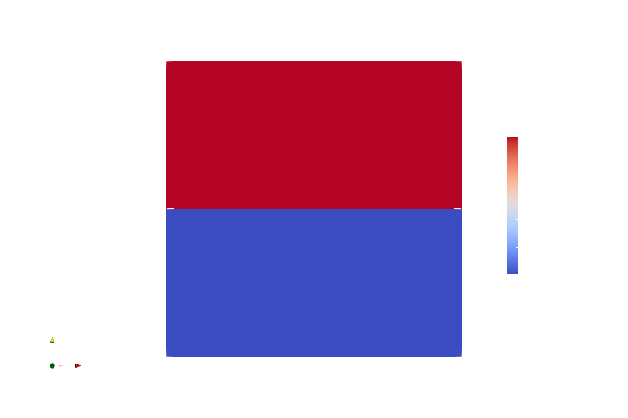
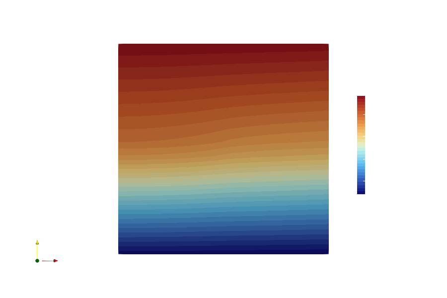

# Condução de calor 2D em placa composta (Jacobi, sequencial e MPI)

Programa em C++ que resolve a equação de condução de calor 2D em regime permanente numa placa formada por quatro materiais, cada um com uma condutividade térmica diferente. Usa diferenças finitas e o método iterativo de Jacobi. Há uma versão sequencial (`main.cpp`) e uma paralela com MPI no modelo de fases paralelas (`heat_mpi.cpp`).

Baseado em [thermeng/2D-Heat-Conduction-Solver-for-CompositePlate](https://github.com/thermeng/2D-Heat-Conduction-Solver-for-CompositePlate), com a versão sequencial reescrita para ficar mais rápida (ver [Otimizações](#otimizações)).

## O problema

- Placa quadrada de 0,1 m × 0,1 m, dividida em quatro quadrantes com k = 50, 100, 150 e 200 W/m·K.
- **Dirichlet:** temperatura fixa na borda superior (100 °C) e na inferior (200 °C).
- **Neumann:** borda esquerda adiabática (sem fluxo de calor).
- **Robin:** convecção na borda direita (h = 50 W/m²·K, fluido a 50 °C).
- Nas interfaces entre materiais, a condutividade da face é a média harmônica das duas.
- As bordas são tratadas com uma camada de células fantasma em volta da grade N × N.

**Critério de parada:** o laço termina quando a variação média por célula entre duas iterações, `Σ|T_novo − T_antigo| / N²`, fica menor ou igual à tolerância. O `maxIter` é só uma trava de segurança. Se ela for atingida, o programa avisa que não convergiu.

## Compilar e rodar

```bash
make
```

```bash
./heat [N] [tol] [maxIter] [--vtk] [--print]
```

| Argumento | Padrão | Significado |
|---|---|---|
| `N` | 16 | células do interior em cada direção |
| `tol` | 1e-6 | tolerância da variação média |
| `maxIter` | 1e8 | trava de segurança |
| `--vtk` | desligado | escreve `temperatureField.vtk` e `K_conductivity.vtk` (abrem no ParaView) |
| `--print` | desligado | imprime o campo no terminal (só para N pequeno) |

Exemplo de saída (`./heat 256`):

```
N               : 256
Tolerância      : 1e-06
Iterações       : 227713
Resíduo final   : 9.9997...e-07
Soma de T       : 10475084.3...
Convergiu       : sim
Tempo init  (s) : ...
Tempo laço  (s) : ...
Tempo saída (s) : ...
Tempo total (s) : ...
Fração fora do laço: ...
```

O número de iterações e a **soma de T** resumem o resultado. Os tempos vêm separados entre inicialização, laço iterativo e saída. A última linha é a fração do tempo gasta fora do laço.

O número de iterações do Jacobi cresce com N²: cerca de 1,6 mil para N = 16, 66 mil para N = 128 e 228 mil para N = 256.

## Versão paralela (MPI)

```bash
make heat_mpi
```

```bash
mpirun -np 4 ./heat_mpi [N] [tol] [maxIter] [--vtk] [--print]
```

Os argumentos são os mesmos da versão sequencial, com `N` maior ou igual ao número de processos.

**Divisão dos dados:** cada processo fica com um bloco de linhas consecutivas da grade (N/P linhas; quando a divisão não é exata, os primeiros processos ficam com uma a mais), mais uma linha fantasma em cima e outra embaixo. O primeiro processo guarda a borda superior (Dirichlet) e o último, a inferior.

**As três fases**, repetidas a cada iteração por todos os processos:

1. **Cálculo:** condições de contorno das bordas esquerda e direita e varredura de Jacobi no próprio bloco, com as mesmas contas da versão sequencial.
2. **Verificação:** cada processo soma `|T_novo − T_antigo|` no seu bloco, e um único `MPI_Allreduce` (soma) entrega o total a todos. Como todos recebem o mesmo valor, todos decidem parar na mesma iteração.
3. **Troca:** cada processo manda a primeira linha do bloco ao vizinho de cima e a última ao de baixo, com dois `MPI_Sendrecv`. Elas viram as linhas fantasma do vizinho na próxima iteração. Nas pontas, o vizinho é `MPI_PROC_NULL`, e a borda Dirichlet fica como está. Na última iteração a troca não é feita.

No fim, o campo é juntado no processo 0 (`MPI_Gatherv`), que calcula a soma de T na mesma ordem da versão sequencial e grava o VTK se pedido.

**Equivalência:** o Jacobi não depende da ordem em que as células são atualizadas, e cada célula é calculada com os mesmos valores e as mesmas operações da versão sequencial. Por isso o campo final é idêntico bit a bit. Conferido com N = 16, 64, 100 e 255 e com 1, 2, 3, 4 e 7 processos: o mesmo número de iterações, o mesmo resíduo final e a mesma soma de T em todos os dígitos impressos, e o VTK idêntico byte a byte.

**Tempos das fases:** além das linhas da versão sequencial, o processo 0 imprime o tempo de cada fase (mínimo, média e máximo entre os processos) e uma estimativa da espera pelo processo mais lento:

```
Fases (s), entre os processos: mín méd máx
Cálculo     (s) : ...
Verificação (s) : ...
Troca       (s) : ...
Espera verif.   (s) : ...
Espera troca    (s) : ...
```

O processo que chega por último a uma comunicação quase não espera. Então o mínimo entre os processos estima o custo da comunicação em si, e a média menos o mínimo estima quanto cada processo ficou, em média, esperando o mais lento.

## Rodando no Atlântica (Slurm)

Da raiz do repositório:

```bash
sbatch sequencial.sbatch
```

```bash
sbatch sequencial.sbatch 1024 1e-6 1
```

Os argumentos são `N`, `tol` e o número de repetições. O padrão é `1024 1e-6 1`.

O script:
- pede um nó exclusivo, com limite de 8 h;
- compila no próprio nó de cálculo, porque `-march=native` gera código para a CPU onde compila, e põe o binário numa pasta temporária do job;
- roda o solver preso a um núcleo;
- grava tudo em `saidas/heat-seq-<jobid>.out`.

Limites do Atlântica: **no máximo 2 jobs na fila por usuário**, e o tempo máximo do job depende de quantos nós ele pede:

| Nós | Tempo máximo |
|---|---|
| 1 | 16 h |
| 2 | 8 h |
| 4 | 4 h |
| 8 | 2 h |
| 16 | 1 h |

Por causa do limite de 2 jobs na fila, as repetições devem ficar dentro do mesmo job (3º argumento), e não espalhadas em vários jobs.

Cada repetição termina com uma linha `RESULTADO ...` (iterações, soma de T, tempos e fração fora do laço), fácil de filtrar:

```bash
grep RESULTADO saidas/*.out
```

**Por que `N = 1024` e `tol = 1e-6`:** com 64 processos, cada um fica com 16 linhas. Assim o cálculo de cada iteração pesa mais que a comunicação (`MPI_Allreduce` e troca de bordas), e o speed-up fica mais perto do ideal do que com `N = 512`. Com essa tolerância, a temperatura média para a cerca de 0,45 °C da solução exata.

**Referência do T1 no Atlântica** (job 47421, Xeon E5520, saída em [`saidas/heat-seq-47421.out`](saidas/heat-seq-47421.out)):

| Iterações | Soma de T | Tempo do laço | Fração fora do laço |
|---|---|---|---|
| 2 449 575 | 167156330.0959675014 | 16 515 s (4 h 35 min) | 0,000007 |

A versão paralela tem de dar exatamente o mesmo número de iterações. A soma de T pode diferir nos últimos dígitos, porque a redução soma em outra ordem. O T1 foi medido uma vez só, por causa do tempo; os paralelos são repetidos 10 vezes.

Referência medida com `N = 512` e `tol = 1e-6`: 760 604 iterações, soma de T = 41874765.40..., cerca de 5,5 min por repetição no mesmo i7-1355U.

Se o Atlântica exigir uma partição ou um módulo de compilador, ajuste as linhas comentadas `--partition` e `module load` no início do script.

### Versão paralela (MPI)

O `paralelo.sbatch` compila a versão MPI (`heat_mpi.cpp`, com `mpicxx`) e roda P processos várias vezes:

```bash
sbatch -J <nome> --nodes=<nós> --ntasks-per-node=<P/nós> --time=<limite> paralelo.sbatch P [repetições] [primeira] [N] [tol]
```

O padrão é 10 repetições, começando na 1, com `N = 1024` e `tol = 1e-6`.

Os 8 jobs das 10 repetições, respeitando os nós do enunciado e os limites do cluster:

| P | Nós | Repetições | Comando |
|---|---|---|---|
| 2 | 1 | 1 a 5 | `sbatch -J heat-p2 --nodes=1 --ntasks-per-node=2 --time=16:00:00 paralelo.sbatch 2 5 1` |
| 2 | 1 | 6 a 10 | `sbatch -J heat-p2 --nodes=1 --ntasks-per-node=2 --time=16:00:00 paralelo.sbatch 2 5 6` |
| 4 | 1 | 1 a 5 | `sbatch -J heat-p4 --nodes=1 --ntasks-per-node=4 --time=16:00:00 paralelo.sbatch 4 5 1` |
| 4 | 1 | 6 a 10 | `sbatch -J heat-p4 --nodes=1 --ntasks-per-node=4 --time=16:00:00 paralelo.sbatch 4 5 6` |
| 8 | 1 | 1 a 10 | `sbatch -J heat-p8 --nodes=1 --ntasks-per-node=8 --time=16:00:00 paralelo.sbatch 8` |
| 16 | 2 | 1 a 10 | `sbatch -J heat-p16 --nodes=2 --ntasks-per-node=8 --time=08:00:00 paralelo.sbatch 16` |
| 32 | 4 | 1 a 10 | `sbatch -J heat-p32 --nodes=4 --ntasks-per-node=8 --time=04:00:00 paralelo.sbatch 32` |
| 64 | 4 | 1 a 10 | `sbatch -J heat-p64 --nodes=4 --ntasks-per-node=16 --ntasks-per-core=2 --time=04:00:00 paralelo.sbatch 64` |

Como só cabem 2 jobs na fila, comece pelos de P = 2, que são os mais longos (cerca de 2 h 20 por repetição no caso ideal).

O script:
- confere se o job tem P tarefas e avisa se o número de nós não for o do enunciado;
- usa um processo por núcleo físico, e só usa HT quando há mais processos que núcleos (P = 64);
- alterna os processos entre os dois soquetes de cada nó, para usar os dois controladores de memória;
- compila numa pasta `build/<jobid>` dentro do repositório, visível em todos os nós, e apaga essa pasta no fim;
- imprime uma linha `RESULTADO P=... rep=...` por repetição, com `equivalente=sim` quando o número de iterações bate com o do T1, `soma_igual=sim` quando a soma de T bate em todos os dígitos, e os tempos médios das fases (`calc_s`, `verif_s`, `troca_s`) e das esperas (`espera_verif_s`, `espera_troca_s`).

Se um job for cancelado por tempo, as repetições que terminaram ficam na saída. Para completar as que faltaram, use o 3º argumento. Por exemplo, se o job de P = 32 parou depois da 7ª:

```bash
sbatch -J heat-p32 --nodes=4 --ntasks-per-node=8 --time=04:00:00 paralelo.sbatch 32 3 8
```

**Rede:** os nós do Atlântica têm 4 placas de 1 Gb/s (`eno1` a `eno4`), sem InfiniBand, e o Open MPI usa todas por padrão. No primeiro teste com P = 32 (job 47521), a troca de bordas de um processo levou cerca de 1,3 ms por iteração, o tempo de duas mensagens de 8 KB a 100 Mb/s. O `rede.sbatch` mede a troca entre os nós de duas formas, com todas as placas e com cada uma sozinha: um ping-pong (`pingpong.cpp`) entre dois processos em nós diferentes, que dá a latência e a velocidade para mensagens de 8 B a 4 MB (8 KB é o tamanho de uma linha de borda com N = 1024), e 20 000 iterações do solver com P = 32, que dão o tempo por iteração. O ping-pong também roda dentro de um nó, como referência:

```bash
sbatch rede.sbatch
```

A placa mais rápida vai na variável `BTL_IF` do `paralelo.sbatch` (por exemplo, `BTL_IF=eno1 sbatch ...`).

Variáveis opcionais: `MPI_SRC` (fontes, padrão `heat_mpi.cpp vtkWriter.cpp`), `MPICXX`, `LAUNCHER` e `BTL_IF`. Se o MPI do Atlântica não funcionar com `srun`, use `LAUNCHER=mpirun`:

```bash
LAUNCHER=mpirun sbatch -J heat-p2 --nodes=1 --ntasks-per-node=2 --time=16:00:00 paralelo.sbatch 2 5 1
```

## Otimizações

Comparadas com o código original:

1. **Sem saída dentro do laço.** O original imprimia uma linha por iteração e o campo inteiro no final. Agora só o resumo é impresso, e o VTK e o campo só com `--vtk` e `--print`.
2. **Troca de ponteiros em vez de cópia.** O original copiava a grade inteira (`oldTemperature = temperature`) a cada iteração.
3. **Arrays planos e contíguos** (`std::vector<double>` de (N+2)² posições) no lugar de `vector<vector<double>>`.
4. **Resíduo calculado no mesmo laço da atualização**, sem o array `residualField` e sem um segundo laço sobre a grade.
5. **Coeficientes já divididos por `a_P`.** São quatro arrays em vez de cinco, e não há divisão por célula a cada iteração.
6. **Bordas mais baratas.** As linhas Dirichlet, que são constantes, são escritas uma vez só. A borda Robin usa dois coeficientes pré-calculados por linha, em vez de um `std::map::at` por célula a cada iteração.
7. **N, tolerância e trava lidos da linha de comando**, e Makefile com `-O3 -march=native`.

**Correção:** no original, as condições de contorno eram aplicadas *depois* de copiar o campo para `oldTemperature`, mas a varredura lê `oldTemperature`. Por isso as células fantasma ficavam uma iteração atrasadas. O resultado final é o mesmo, mas o original levava mais iterações (1666 contra 1618 para N = 16). Com a ordem corrigida no código original, as duas versões dão o mesmo número de iterações e o mesmo campo (conferido para N = 16 e N = 64).

### Tempo (mesma máquina, 10 000 iterações fixas, `-O3 -march=native`)

| N | Original | Otimizado | Ganho |
|---|---|---|---|
| 128 | 0,23 s | 0,11 s | 2,1× |
| 256 | 1,37 s | 0,70 s | 2,0× |
| 512 | 8,18 s | 3,95 s | 2,1× |
| 1024 | 40,2 s | 19,4 s | 2,1× |

Para N grande, o laço é limitado pela memória: por célula, ele lê quatro coeficientes e escreve um valor novo.

## Visualização

| Mapa de materiais | Temperatura |
|---|---|
|  |  |
|  |  |
|  |  |
