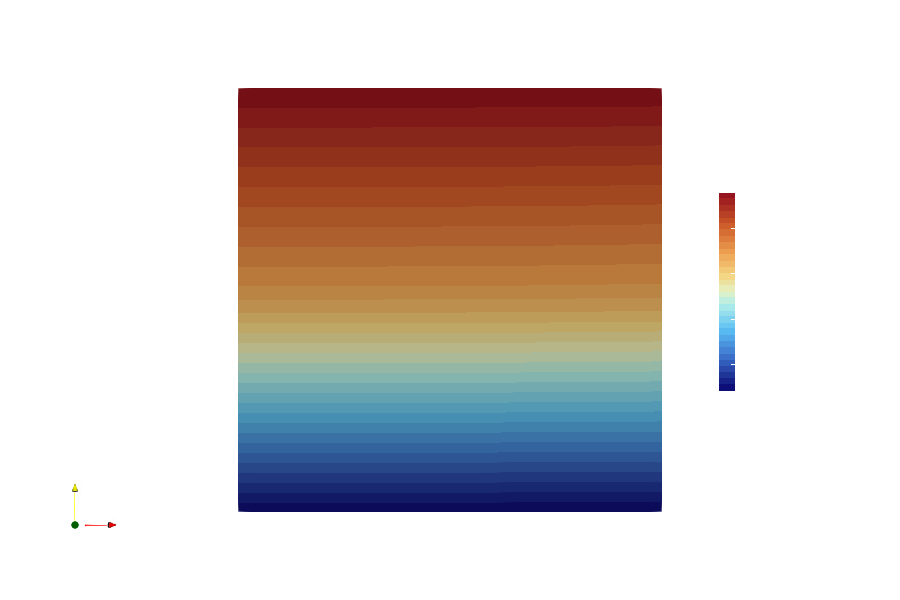
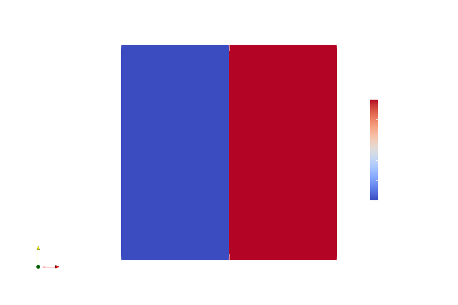
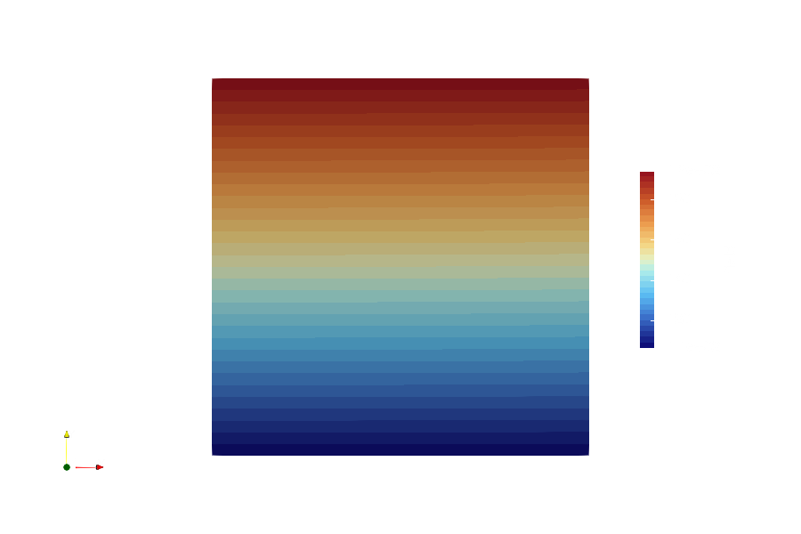
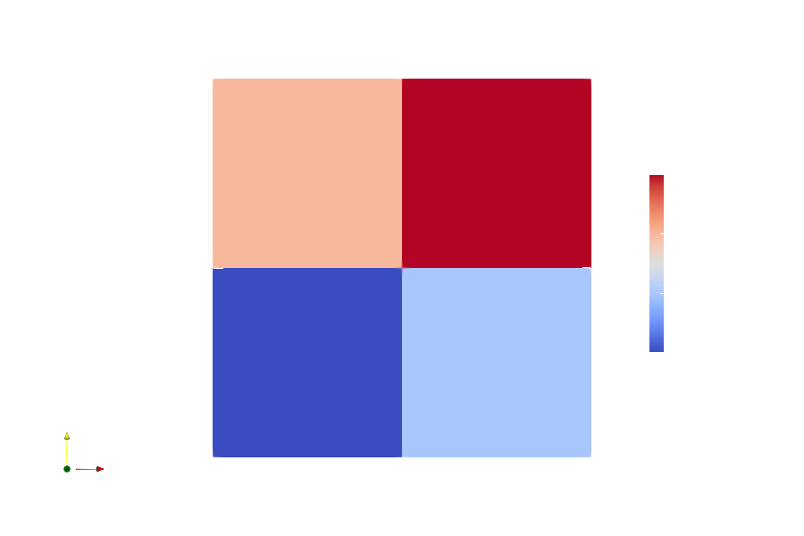

# Condução de calor 2D em placa composta (Jacobi, sequencial)

Programa em C++ que resolve a equação de condução de calor 2D em regime permanente numa placa formada por quatro materiais, cada um com uma condutividade térmica diferente. Usa diferenças finitas e o método iterativo de Jacobi.

Baseado em [thermeng/2D-Heat-Conduction-Solver-for-CompositePlate](https://github.com/thermeng/2D-Heat-Conduction-Solver-for-CompositePlate), com a versão sequencial reescrita para ficar mais rápida (ver [Otimizações](#otimizações)).

## O problema

- Placa quadrada de 0,1 m × 0,1 m, dividida em quatro quadrantes com k = 50, 100, 150 e 200 W/m·K.
- **Dirichlet:** temperatura fixa na borda superior (100 °C) e na inferior (200 °C).
- **Neumann:** borda esquerda adiabática (sem fluxo de calor).
- **Robin:** convecção na borda direita (h = 50 W/m²·K, fluido a 50 °C).
- Nas interfaces entre materiais, a condutividade da face é a média harmônica das duas.
- As bordas são tratadas com uma camada de células fantasma em volta da grade N × N.

**Critério de parada:** o laço termina quando a variação média por célula entre duas iterações, `Σ|T_novo − T_antigo| / N²`, fica menor ou igual à tolerância. O `maxIter` é só uma trava de segurança. Se ela for atingida, o programa avisa que não convergiu.

## Compilar e rodar

```bash
make
```

```bash
./heat [N] [tol] [maxIter] [--vtk] [--print]
```

| Argumento | Padrão | Significado |
|---|---|---|
| `N` | 16 | células do interior em cada direção |
| `tol` | 1e-6 | tolerância da variação média |
| `maxIter` | 1e8 | trava de segurança |
| `--vtk` | desligado | escreve `temperatureField.vtk` e `K_conductivity.vtk` (abrem no ParaView) |
| `--print` | desligado | imprime o campo no terminal (só para N pequeno) |

Exemplo de saída (`./heat 256`):

```
N               : 256
Tolerância      : 1e-06
Iterações       : 227713
Resíduo final   : 9.9997...e-07
Soma de T       : 10475084.3...
Convergiu       : sim
Tempo init  (s) : ...
Tempo laço  (s) : ...
Tempo saída (s) : ...
Tempo total (s) : ...
Fração fora do laço: ...
```

O número de iterações e a **soma de T** resumem o resultado. Os tempos vêm separados entre inicialização, laço iterativo e saída. A última linha é a fração do tempo gasta fora do laço.

O número de iterações do Jacobi cresce com N²: cerca de 1,6 mil para N = 16, 66 mil para N = 128 e 228 mil para N = 256.

## Rodando no Atlântica (Slurm)

Da raiz do repositório:

```bash
sbatch sequencial.sbatch
```

```bash
sbatch sequencial.sbatch 1024 1e-6 1
```

Os argumentos são `N`, `tol` e o número de repetições. O padrão é `1024 1e-6 1`.

O script:
- pede um nó exclusivo, com limite de 8 h;
- compila no próprio nó de cálculo, porque `-march=native` gera código para a CPU onde compila, e põe o binário numa pasta temporária do job;
- roda o solver preso a um núcleo;
- grava tudo em `saidas/heat-seq-<jobid>.out`.

Limites do Atlântica: **no máximo 2 jobs na fila por usuário**, e o tempo máximo do job depende de quantos nós ele pede:

| Nós | Tempo máximo |
|---|---|
| 1 | 16 h |
| 2 | 8 h |
| 4 | 4 h |
| 8 | 2 h |
| 16 | 1 h |

Por causa do limite de 2 jobs na fila, as repetições devem ficar dentro do mesmo job (3º argumento), e não espalhadas em vários jobs.

Cada repetição termina com uma linha `RESULTADO ...` (iterações, soma de T, tempos e fração fora do laço), fácil de filtrar:

```bash
grep RESULTADO saidas/*.out
```

**Por que `N = 1024` e `tol = 1e-6`:** com 64 processos, cada um fica com 16 linhas. Assim o cálculo de cada iteração pesa mais que a comunicação (`MPI_Allreduce` e troca de bordas), e o speed-up fica mais perto do ideal do que com `N = 512`. Com essa tolerância, a temperatura média para a cerca de 0,45 °C da solução exata. **Referência do T1 no Atlântica** (job 47421, Xeon E5520, saída em [`saidas/heat-seq-47421.out`](saidas/heat-seq-47421.out)):

| Iterações | Soma de T | Tempo do laço | Fração fora do laço |
|---|---|---|---|
| 2 449 575 | 167156330.0959675014 | 16 515 s (4 h 35 min) | 0,000007 |

A versão paralela tem de dar exatamente o mesmo número de iterações. A soma de T pode diferir nos últimos dígitos, porque a redução soma em outra ordem. O T1 foi medido uma vez só, por causa do tempo; os paralelos são repetidos 10 vezes.

Referência medida com `N = 512` e `tol = 1e-6`: 760 604 iterações, soma de T = 41874765.40..., cerca de 5,5 min por repetição no mesmo i7-1355U.

Se o Atlântica exigir uma partição ou um módulo de compilador, ajuste as linhas comentadas `--partition` e `module load` no início do script.

## Otimizações

Comparadas com o código original:

1. **Sem saída dentro do laço.** O original imprimia uma linha por iteração e o campo inteiro no final. Agora só o resumo é impresso, e o VTK e o campo só com `--vtk` e `--print`.
2. **Troca de ponteiros em vez de cópia.** O original copiava a grade inteira (`oldTemperature = temperature`) a cada iteração.
3. **Arrays planos e contíguos** (`std::vector<double>` de (N+2)² posições) no lugar de `vector<vector<double>>`.
4. **Resíduo calculado no mesmo laço da atualização**, sem o array `residualField` e sem um segundo laço sobre a grade.
5. **Coeficientes já divididos por `a_P`.** São quatro arrays em vez de cinco, e não há divisão por célula a cada iteração.
6. **Bordas mais baratas.** As linhas Dirichlet, que são constantes, são escritas uma vez só. A borda Robin usa dois coeficientes pré-calculados por linha, em vez de um `std::map::at` por célula a cada iteração.
7. **N, tolerância e trava lidos da linha de comando**, e Makefile com `-O3 -march=native`.

**Correção:** no original, as condições de contorno eram aplicadas *depois* de copiar o campo para `oldTemperature`, mas a varredura lê `oldTemperature`. Por isso as células fantasma ficavam uma iteração atrasadas. O resultado final é o mesmo, mas o original levava mais iterações (1666 contra 1618 para N = 16). Com a ordem corrigida no código original, as duas versões dão o mesmo número de iterações e o mesmo campo (conferido para N = 16 e N = 64).

### Tempo (mesma máquina, 10 000 iterações fixas, `-O3 -march=native`)

| N | Original | Otimizado | Ganho |
|---|---|---|---|
| 128 | 0,23 s | 0,11 s | 2,1× |
| 256 | 1,37 s | 0,70 s | 2,0× |
| 512 | 8,18 s | 3,95 s | 2,1× |
| 1024 | 40,2 s | 19,4 s | 2,1× |

Para N grande, o laço é limitado pela memória: por célula, ele lê quatro coeficientes e escreve um valor novo.

## Visualização

| Mapa de materiais | Temperatura |
|---|---|
|  |  |
|  |  |
|  |  |
